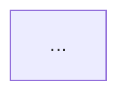

# Implementation Review Docs

## Overview

구현 계획(또는 이미 끝난 변경)을 **리뷰어가 코드를 열지 않고 검토할 수 있는 문서 묶음**으로 옮긴다. 부모 페이지 1개 + 하위 문서 최대 5개 구조다.

**핵심 원칙: 계획서를 요약하는 게 아니라 리뷰어의 질문에 답한다.** 리뷰어는 "뭘 바꿨나"보다 "왜 그렇게 했나", "이 경로에서는 어떻게 되나", "무엇이 깨질 수 있나"를 묻는다. 각 문서는 그 질문에 답하는 형태여야 한다.

## When to Use

- 구현 계획을 팀원·상급자가 검토해야 하는데 계획서가 너무 길거나 실행 지시 위주일 때
- 끝난 변경의 설계 근거를 남겨야 할 때
- 사용자가 "리뷰 문서", "검토용 문서", "컨플루언스에 정리"를 요청할 때

**사용하지 않는 경우**
- 릴리스 노트·사용자 매뉴얼 — 이 문서군은 개발자 리뷰용이다
- 계획서 자체를 그대로 올리는 것 — 그건 첨부지 이 스킬이 아니다

## Inputs

시작 전에 확보한다. 없으면 사용자에게 묻는다.

| 입력 | 용도 |
| --- | --- |
| 구현 계획서 또는 설계 문서 경로 | 주 근거. 없으면 diff·커밋 범위 |
| 부모 페이지 URL 또는 ID | 하위 문서를 붙일 자리 |
| 이슈 키 | 문서 제목 접두어 (`PROJ-388 시퀀스`) |
| 참고할 기존 문서군 | 형식을 맞출 대상이 따로 있으면 |

**설계 문서가 있으면 그것을 우선 근거로 쓴다.** 계획서는 실행 지시라 "왜"가 얇다. 설계 문서에 기각한 대안·판단 근거가 있으면 그쪽을 옮긴다.

## 문서 구성 — 있는 것만 만든다

| 문서 | 만드는 조건 | 건너뛰는 경우 |
| --- | --- | --- |
| **부모(개요)** | 항상 | — |
| **주요 로직 변화** | 항상 | — |
| **API 명세** | 엔드포인트·요청/응답 계약이 바뀔 때 | 내부 로직만 바뀐 변경 |
| **테이블 명세** | 스키마·컬럼·저장값·설정값이 바뀔 때 | 저장 구조 변화가 없을 때 |
| **CRC 모델** | 구성요소가 여럿이고 책임 분담이 리뷰 대상일 때 | 한두 파일 수정 |
| **시퀀스** | 여러 구성요소를 거치는 흐름이 있을 때 | 단일 함수 변경 |

**빈 문서를 만들지 않는다.** API 변경이 없는데 "API 명세 — 변경 없음" 페이지를 만들면 리뷰어의 시간을 뺏는다. 대신 **부모 페이지의 "문서 구성" 절에 왜 없는지 한 줄** 적는다.

반대로 이 다섯 개로 안 담기는 게 있으면 문서를 **추가**한다. 예: 화면 변화가 핵심이면 "화면 변화", 데이터 이관이 있으면 "마이그레이션 절차".

## 공통 규약

모든 문서가 지킨다.

1. **첫 줄은 목적 인용구.** `> **목적**: <이 문서가 무엇을 정리하는지 한 문장>`
2. **평서체.** "한다 / 된다 / 이다". 존댓말·권유형 안 쓴다.
3. **한국어 본문, 식별자는 원문.** 클래스·함수·컬럼·상수는 백틱으로 감싸 원문 그대로.
4. **표를 기본 도구로 쓴다.** 비교·목록·매핑은 산문보다 표가 낫다.
5. **"왜"를 반드시 남긴다.** 각 문서에 판단 근거를 적는 자리를 둔다(설계 판단 메모, …한 이유, 기각한 대안).
6. **제거된 것을 명시한다.** 무엇이 사라졌는지는 리뷰어가 가장 놓치기 쉽다.
7. **남은 위험을 숨기지 않는다.** 완화했을 뿐 근본 해결이 아닌 것, 범위 밖으로 남긴 것을 적는다.
8. **줄번호를 쓰지 않는다.** 파일명·클래스명·함수명으로 가리킨다. 줄번호는 몇 주면 틀린다.
9. **확인하지 않은 것을 단정하지 않는다.** 계획서에 "확인 필요"로 남은 항목은 문서에도 미확정으로 표시한다.

### Mermaid — 반드시 HTML 로 게시한다

**`contentFormat: "markdown"` 으로 ```mermaid 펜스를 보내면 다이어그램이 렌더되지 않는다.** Confluence 가 그것을 레거시 `code` 매크로(`<ac:structured-macro ac:name="code">` + `language=mermaid`)로 변환하는데, mermaid 렌더러는 그 매크로를 처리하지 않는다. 코드 텍스트만 보인다.

**렌더되는 형식은 `<pre><code class="language-mermaid">` 하나다.** 따라서 mermaid 가 들어가는 문서는 `contentFormat: "html"` 로 게시하고 아래 형태로 쓴다.

```html
<h2>협력 관계</h2>
<pre><code class="language-mermaid">flowchart TB
    A[&quot;클라이언트&quot;] --&gt;|요청| B[&quot;서버&quot;]
</code></pre>
```

**이스케이프가 필수다.** `<pre><code>` 안이라도 HTML 파서를 거치므로 아래를 반드시 치환한다. 빠뜨리면 다이어그램이 깨지거나 게시가 거부된다.

| 원문 | 치환 |
| --- | --- |
| `&` | `&amp;` |
| `<` | `&lt;` |
| `>` | `&gt;` |
| `"` | `&quot;` |

즉 `A["라벨"] -->|텍스트| B` 는 `A[&quot;라벨&quot;] --&gt;|텍스트| B` 로 쓴다. `-->`·`-.->`·`--x`·`->>`·`-->>` 가 전부 해당한다.

**게시 후 확인한다.** 응답 `body.storage.value` 에 `<ac:structured-macro ac:name="code"` 가 보이면 실패한 것이다. `language-mermaid` 가 보여야 성공이다.

라벨은 한국어로 쓰되 참여자 별칭은 짧은 영문으로 둔다.

**mermaid 가 없는 문서는 markdown 으로 게시해도 된다.** 표·목록·코드 블록은 markdown 이 훨씬 간단하다. 다만 한 문서 안에 mermaid 가 하나라도 있으면 그 문서 전체를 HTML 로 쓴다.

## 문서별 구조

### 부모(개요)

리뷰어가 여기만 읽고도 변경의 성격과 범위를 알 수 있어야 한다.

```
> **목적**: <한 문장>

## 개요
<문제 → 원인 → 해결 방향. 3~5문장. 배경을 모르는 사람 기준>

## 핵심 전환 요약
| 구분 | 기존 | 변경 후 |

## 변경 스펙 요약
<사용자·운영자에게 달라지는 지점. 대상(학습자/교수자/운영자)별로>
| 대상 | 기존 | 변경 후 | 이슈 |

## 운영 전제
<설계에 직접 영향을 준 환경 조건. 없으면 생략>

## 문서 구성
* **주요 로직 변화** — <한 줄>
* **API 명세** — <한 줄>   ← 안 만든 문서는 왜 없는지 여기 적는다
...

## 이 문서가 다루는 범위
<범위 밖을 명시. 같은 릴리스에 있지만 여기서 안 다루는 것>
```

### 주요 로직 변화

가장 중요한 문서다. **번호 목록으로 핵심 변화를 나열**하고, 각 항목은 굵은 제목 + 설명 문단으로 쓴다.

```
> **목적**: <한 문장>

## 기존 구조
<불릿. 지금 어떻게 동작하는지>

## 개선 구조의 핵심 변화
1. **<변화의 제목>**: <무엇이 어떻게 바뀌는지, 왜 그렇게 하는지>
2. ...

## <주제별 상세>
<표. 예: 동시성 제어, 유형 판정 규칙, 분기 조건>

## 안정성·호환성 보강
| 구분 | 내용 |

## 호환성 유의
<기존 데이터·설정과 부딪히는 지점>
```

### API 명세

```
> **목적**: <한 문장>

## 엔드포인트 목록
| 메서드 | 경로 | 설명 |    ← 신규는 **굵게 + (신규)**

## 접근 제어
<권한 요구와 식별자 해소 경로>

## <엔드포인트별 절>
### 요청 본문
| 필드 | 타입 | 설명 |
### 응답 (상태코드)
```json
<예시>
```

## 실패 사유 코드
| 코드 | 의미 |

## 제거된 엔드포인트
```

응답 필드가 늘어난 경우 **어떤 필드가 신설인지** 표시한다. 리뷰어가 가장 먼저 보는 게 계약 변화다.

### 테이블 명세

```
> **목적**: <한 문장>

## `<테이블/컬렉션명>`
<소프트삭제·타임스탬프 등 공통 성질 한 줄>

| 필드 | 타입 | 설명 | 인덱스 |    ← 신규는 **굵게 + 신규**

### `<열거 컬럼>` 값
| 값 | 의미 |

### 상태 전이 규칙
<동시 쓰기·되돌림 금지 등 제약>

## 설정값 / 옵션
| 이름 | 기본값 | 설명 | 변경 경로 |

## 마이그레이션
<파일명, 되돌리기 동작, 기존 값 보존 여부>

## 변경 유의
<기존 데이터에 남아 있을 수 있는 값 등>
```

**저장되는 값이 상수인 경우 그 값을 그대로 적는다.** 나중에 바꾸려면 데이터 마이그레이션이 필요한지도 함께.

### CRC 모델

```
> **목적**: <한 문장>

## 개요
<구성요소를 몇 개 영역으로 나눴는지, 영역 간 결합 조건>

## 협력 관계


## CRC 카드
| 구성요소 | 책임 (Responsibility) | 협력 (Collaborators) |

## 설계 판단 메모
* **<A를 별도로 뺀 이유>** — <그렇게 안 하면 무엇이 깨지는지>

## 이전 설계에서 제거된 것
```

**구성요소 이름은 한국어로 쓴다**(생성 요청 처리기, 퀴즈 서비스). 클래스명을 그대로 쓰면 리뷰어가 코드를 열어야 한다. 다만 CRC 카드 설명 안에서는 실제 식별자를 백틱으로 병기해도 좋다.

### 시퀀스

정상 흐름만 그리면 리뷰 가치가 절반이다. **실패·중단·복구 흐름을 반드시 포함한다.**

```
> **목적**: <한 문장>

## 흐름 1 — <제목>
<한두 문장 설명>
```mermaid
sequenceDiagram
...
```
<다이어그램이 담지 못한 판단 근거를 뒤에 산문으로>

## 흐름 2 — ...
...

## 남은 위험
| 조건 | 이 설계의 대응 | 근본 해결 |
```

흐름 구성 기준:
- 흐름 1~2: 정상 경로 (주 시나리오, 조회/폴링)
- 흐름 3~: 부분 실패, 전체 실패, 재실행, 유실 복구
- 각 흐름은 **하나의 질문에 답한다.** "이때 어떻게 되나?"

## Workflow

### 1. 근거 수집

계획서·설계 문서를 읽는다. **계획서에 없는 내용은 코드에서 확인한다.** 추측으로 채우지 않는다.

확인이 필요한데 못 한 항목은 목록으로 남겨 사용자에게 알린다.

### 2. 문서 세트 결정

위 조건표로 만들 문서를 정한다. 사용자에게 **무엇을 만들고 무엇을 왜 건너뛰는지** 한 번 보여주고 진행한다.

### 3. 부모 페이지 작성

부모부터 쓴다. 개요를 쓰면서 전체 구조가 정리된다.

부모 페이지가 이미 있으면 `updateConfluencePage`, 없으면 `createConfluencePage`.

### 4. 하위 문서 작성·게시

각 문서를 `createConfluencePage` 로 만들되 `parentId` 를 부모 페이지 ID 로 준다.

- **mermaid 가 있는 문서는 `contentFormat: "html"`** — `<pre><code class="language-mermaid">` 로 써야 렌더된다. 위 "Mermaid" 절 참조
- mermaid 가 없는 문서는 `contentFormat: "markdown"` 이 간단하다
- 제목은 `<이슈키> <문서명>` 형식. 예: `PROJ-388 시퀀스`
- 게시 후 응답의 `body.storage.value` 에서 mermaid 가 `language-mermaid` 로 들어갔는지 확인한다

### 5. 부모의 "문서 구성" 절에 링크 확인

하위 페이지는 Confluence 트리에 자동으로 붙지만, 부모 본문의 "문서 구성" 목록이 실제 만든 문서와 일치하는지 확인한다.

### 6. 보고

만든 페이지 목록과 URL, 그리고 **문서에 담지 못한 미확정 항목**을 함께 보고한다.

## Common Mistakes

| 실수 | 올바른 처리 |
| --- | --- |
| **mermaid 를 markdown 펜스로 게시** | 레거시 `code` 매크로로 변환되어 다이어그램이 안 나온다. `contentFormat: "html"` + `<pre><code class="language-mermaid">` |
| **mermaid 안에서 HTML 이스케이프 누락** | `-->` → `--&gt;`, `"` → `&quot;`. 안 하면 깨지거나 게시가 거부된다 |
| 계획서의 태스크 목록을 그대로 옮김 | 리뷰어는 실행 순서가 아니라 설계 판단을 본다. 태스크가 아니라 변화와 근거로 재구성 |
| "무엇을" 만 적고 "왜" 를 뺌 | 각 문서에 판단 근거 자리를 둔다. 기각한 대안이 있으면 반드시 적는다 |
| 변경 없는 영역의 빈 문서 생성 | 만들지 말고 부모의 "문서 구성" 에 이유 한 줄 |
| 줄번호로 위치 지시 | 파일·클래스·함수명으로. 줄번호는 금방 틀린다 |
| 정상 흐름만 시퀀스로 그림 | 실패·재실행·유실 흐름이 리뷰 가치의 절반 |
| 제거된 것을 안 적음 | 리뷰어가 가장 놓치기 쉬운 항목. 별도 절로 |
| 남은 위험을 숨김 | 완화했을 뿐인 것, 범위 밖인 것을 명시 |
| 확인 안 한 걸 단정 | 미확정은 미확정으로 표시하고 사용자에게 보고 |
| 부모 페이지 없이 하위만 생성 | 부모부터. 개요를 쓰는 과정에서 구조가 잡힌다 |
| 존댓말·권유형 사용 | 평서체 |

## Quick Reference

- **부모 1 + 하위 최대 5**: 주요 로직 변화 · API 명세 · 테이블 명세 · CRC 모델 · 시퀀스
- **모든 문서 첫 줄**: `> **목적**: ...`
- **게시**: `createConfluencePage` + `parentId`, `contentFormat: "markdown"`
- **제목**: `<이슈키> <문서명>`
- **없는 것은 만들지 않는다** — 부모에 이유만 적는다
